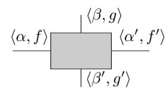
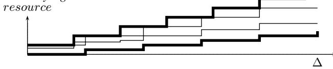
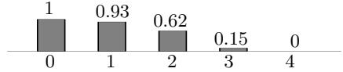
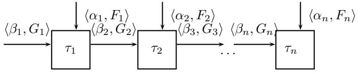
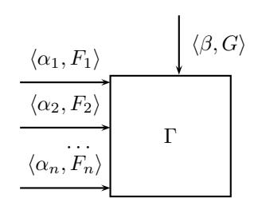
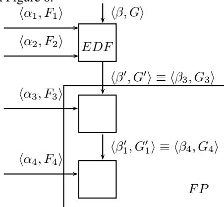
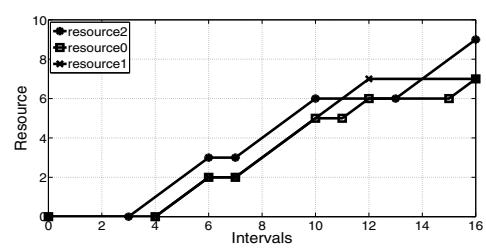
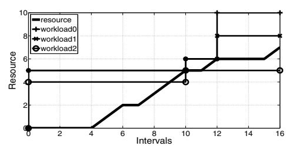

# **A Component-Based Framework for Modeling and Analyzing Probabilistic Real-Time Systems**

L. Santinelli, P. Meumeu Yomsi, D. Maxim and L. Cucu-Grosjean INRIA Nancy Grand-Est

{luca.santinelli, patrick.meumeu, dorin.maxim, liliana.cucu}@inria.fr

# **Abstract**

*A challenging research issue of analyzing a real-time system is to model the tasks composing the system and the resource provided to the system. In this paper, we propose a probabilistic component-based model which abstracts in the interfaces both the functional and non-functional requirements of such systems. This approach allows designers to unify in the same framework probabilistic scheduling techniques and compositional guarantees that go from soft to hard real-time. We provide sufficient schedulability tests for task systems using such framework when the scheduler is either preemptive Fixed-Priority or Earliest Deadline First.*

# **1 Introduction**

The performance of a real-time system rely on both correct executions and results that are produced on time. Over the years, numerous approaches have been proposed for modeling and analyzing real-time systems [7, 23]. These systems are nowadays more complex and therefore they are often seen as a set of independent sub-systems or *components*. This paradigm for addressing real-time issues provides a mean for reducing a single complex design problem into multiple simpler ones. As such, a realtime system is obtained by composing the components through their *interfaces*, each of which abstracts the internal complexity of the component and encodes the timing requirements of the real-time component. In such a process, the original system is using the so-called *hierarchical scheduling* techniques to guarantee temporal isolation between the components.

A commonly used technique in analyzing componentbased systems consists in considering a *worst-case* timing analysis to validate the system. However, a worstcase analysis provides pessimistic results and not all component-based systems can afford such pessimism. The pessimism can be decreased by using different approaches and we are interested in the utilisation of probabilistic approaches for component-based systems.

**Related work** A component-based view of real-time systems is defined such that each system element can be modeled as a component, [7, 24, 11, 9, 20, 19] with an associated interface describing how the component relates to other components as well as the environment [10].

Several timing analysis results are provided for the component-based design problem using the hierarchical scheduling [22, 12, 1, 17] which decomposes the system into many independent applications to which is assigned a fraction of the computational resource through global schedulers.

Concerning the probabilistic approaches, the real-time community has been using terms like *stochastic analysis* regardless of the approach (probabilistic or statistical) [14, 18, 28, 8]. In this paper we use the notion of *probabilistic* approach to indicate that the approach is based on the theory of probability. Moreover, by *probabilistic component-based system* we mean a component-based system with at least one parameter described by a random variable. Therefore a probabilistic analysis consists of the temporal analysis of such systems.

The closest result that could be used for probabilistic component-based modeling is provided in [13] where the authors define the stochastic network calculus, derived from the network calculus [5]. Nevertheless, the stochastic network calculus does not provide results for **real-time** probabilistic component-based systems, as it is the case of the framework we propose here.

**This research** In this paper, we focus and build our contribution on techniques from Real-Time Calculus (RTC) [25], which is a worst-case analysis framework for realtime systems based on deterministic bounds by which the system behavior is modeled: non-deterministic decisions can be taken throughout bounding curves. RTC provides adequate material that characterizes event occurrences related to the passage of a quantitative deterministic time period. As such, non-deterministic decisions can be taken throughout bounding curves. We propose an approach which allows designers to unify in the same framework probabilistic scheduling techniques and compositional guarantees for real-time systems with degrees that go from hard to soft real-time. The probabilistic pa-

rameters and bounds provide a set of functions expressing the resource given to a task flow and the resource demand of the task flow in terms of probabilistic bounds. With those bounds, a schedulability analysis can be carried out. To the best of our knowledge this work is the *first extension* of RTC toward a probabilistic version1.

**Paper organization** The paper is structured as follows. Section 2 presents the probabilistic periodic task model, the scheduler and the resource models that are used throughout the paper. Section 3 provides the reader with basic concepts of probabilistic bounding curves. Section 4 presents inputs and outputs of a probabilistic real-time component. Section 5 yields the correspondence between each task and each resource in terms of probabilistic bounding curves. Section 6 elaborates the schedulability analysis of the system based on these curves. Section 7 presents a case study applying the proposed approach. Finally, Section 8 concludes the paper and proposes future work.

# **2 Model of computation**

We consider here real-time systems with a model of computation consisting of *probabilistic periodic constrained-deadline tasks* and *probabilistic resource provisioning*. This probabilistic model is provided in order to cope with uncertainties that could come from different sources.

### **2.1 Task specifications**

We consider a real-time system  $\Gamma$  composed of  $n$  tasks,  $\Gamma \stackrel{\text{def}}{=} \{\tau_1, \tau_2, \dots, \tau_n\}$ . Each  $\tau_i$  is modeled by a *probabilistic periodic* and *constrained-deadline* task characterized by three parameters  $(\mathcal{C}_i, \mathcal{T}_i, D_i)$  where  $\mathcal{C}_i$  is a random variable2 representing the execution time with a known Probability Function (PF) denoted by  $f_{\mathcal{C}_i}(\cdot)$  with  $f_{\mathcal{C}_i}(c) \stackrel{\text{def}}{=} \mathbb{P}(\mathcal{C}_i = c)$ ,  $\mathcal{T}_i$  is a random variable of the period with a known PF denoted by  $f_{\mathcal{T}_i}(\cdot)$  with  $f_{\mathcal{T}_i}(p) \stackrel{\text{def}}{=} \mathbb{P}(\mathcal{T}_i = p)$  and  $D_i$  is the task relative deadline. The execution time of  $\tau_i$  takes a value bounded by  $[C_i^{\min}, C_i^{\max}]$  whereas the period takes a value bounded by  $[T_i^{\min}, T_i^{\max}]$ . We assume that  $C_i^{\max \leq D_i}$  and  $D_i \leq T_i^{\min}$ .

The PF of  $\mathcal{C}_i$  and  $\mathcal{T}_i$  are respectively represented as follows.

$$\mathcal{C}_i = \begin{pmatrix} C_i^0 = C_{i\max}^{\max} & C_i^1 \\ f_{\mathcal{C}_i}(C_{i\max}^1) & f_{\mathcal{C}_i}(C_i^1) \end{pmatrix}, \quad \begin{pmatrix} C_i^k = C_{i\max}^k \\ f_{\mathcal{C}_i}(C_{i\max}^k) \end{pmatrix} \quad (1)$$

and

$$T_i = \begin{pmatrix} T_i^0 = T_i^{\min} & T_i^1 \\ f_{T_i}(T_i^{\min}) & f_{T_i}(T_i^1) \end{pmatrix}, \quad \dots, \quad \dots, \quad T_i^{\ell_i} = T_i^{\max} \\ f_{T_i}(T_i^{\max}) \end{pmatrix} \quad (2)$$

where  $\sum_{j=0}^{k_i} f_{C_i}(C_i^j) = 1$  and  $\sum_{j=0}^{\ell_i} f_{T_i}(T_i^j) = 1$ . Here,

 $(k_i + 1)$  and  $(\ell_i + 1)$  are respectively the number of computation times and periods representing task  $\tau_i$ . The computation times are ordered in an opposite manner than the periods for sake of readability and ease of representation of the mathematical expressions.

In this paper we assume all the random variables  $\mathcal{C}_i$  and  $\mathcal{T}_i, \forall i \leq n$ , are independent. This assumption is not unrealistic for real systems3. For dependent variables the results presented here could be extended using copulas [3], but this is beyond the purpose of this paper.

All these parameters are given with the interpretation that task  $\tau_i$  generates an infinite number of successive jobs  $\tau_{i,j}$ , with  $j = 1, \dots, \infty$ . Each such job has an execution requirement described by  $\mathcal{C}_i$  where for each value  $C_i^k$ ,  $f_{\mathcal{C}_i}(C_i^k)$  is its probability of occurrence. Instead, the arrival of the jobs is described by  $\mathcal{T}_i$ , e.g. the probability of having  $T_i^k$  as the arrival for the next task job is  $f_{\mathcal{T}_i}(T_i^k)$ . All the jobs are assumed to be independent of other jobs of the same task and those of other tasks.

## **2.2 Scheduler and Resource specifications**

We consider that tasks are scheduled by using a *pre-emptive hierarchical* scheduler4 upon a *uniprocessor* platform. The computational resource is assumed to be the unique resource in this paper. Hierarchical schedulers allow:

- ▷ generalizing the role of schedulers by allowing them to schedule other schedulers, thus leading to isolation properties to be recursively applied to groups of tasks, rather than applying them only to a single task.
- ▷ expressing complex composite schedulers as a collection of small, simple schedulers, thus providing increased flexibility compared to the “one size fits all” schedulers.

Moreover, we consider that the scheduler can be either *Fixed-Priority (FP)* such as *Rate Monotonic (RM)* and *Deadline Monotonic (DM)*, or *Dynamic-Priority (DP)* such as *Earliest Deadline First (EDF)*.

# **3 Concept of probabilistic bounding curves**

RTC allows characterizing a task by the *maximum* amount of computation requested within any interval of time. In the same vein, it allows characterizing a resource via the *minimum* amount of computation that is guaranteed to be delivered in an interval of time. The RTC model relies on curves representing such quantities.

## **3.1 Probabilistic task abstraction**

Since we build our contribution on techniques from RTC, task activations and executions are joined with event streams. Consequently, one can derive an abstraction based on curves which is able to bound the event

1Except for a preliminary version of this paper [21]  
2Everywhere in this paper we will use a calligraphic typeface to denote random variables.

3For more details see <http://www.proartis-project.eu/>

4We assume that every preemption is performed at no cost or penalty.

stream behavior [25]. In such a context, each task  $\tau_i$  generates random request curves depending on both the actual period and execution time of the task at each activation. Considering the function  $R_i(t)$  as the cumulative amount of execution that the probabilistic task  $\tau_i$  has requested up to time  $t$ , each task  $\tau_i$  can be characterized by a request curve  $\alpha_i$  which bounds  $R_i(t)$ .

Parameterizing the request function with a variable  $x$  it follows that for all  $0 \leq s \leq t$  and  $\Delta \stackrel{\text{def}}{=} t - s$ , the upper bounding request curve  $\alpha_i(\Delta, x) \stackrel{\text{def}}{=} \alpha_i(\Delta, \cdot) - x$  is such that  $\alpha_i(\Delta, \cdot) - [R_i(t) - R_i(s)] \geq x$ . Hence, we can define the probabilistic request curve from [27] as follows.

**Definition 1** (Probabilistic request curve). *The request curve  $\alpha_i(\Delta, x)$  of a request  $R_i$  is a non-decreasing non-negative function which satisfies*

$$\mathbb{P} (\alpha_i(\Delta, \cdot) - [R_i(t) - R_i(s)] \geq x) \leq f_i(x) \quad (3)$$

for all  $0 \leq s \leq t$  and  $x \geq 0$ .

In Inequality (3),  $f_i(x)$  is the probability that  $\alpha_i(\Delta, x)$  upper bounds the request curve of  $\tau_i$  in the interval  $[s, t]$ .

# **3.2 Probabilistic resource abstraction**

It is possible to derive an abstraction based on curves for the resource provisioning by following the same reasoning as for tasks. Naming  $S(t)$  the total amount of resource provided at time  $t$ , the resource provisioning is characterized by considering the lower bounding service curve  $\beta$  as a function of  $S(t)$ .

Parameterizing the resource provisioning function with a variable  $y$ , it follows that for all  $0 \leq s \leq t$  and  $\Delta \stackrel{\text{def}}{=} t - s$ , the lower bounding service curve  $\beta(\Delta, y) \stackrel{\text{def}}{=} \beta(\Delta, \cdot) + y$  is such that  $[S(t) - S(s)] - \beta(\Delta, \cdot) \geq y$ . Hence, we can define the probabilistic service curve from [27] as follows.

**Definition 2** (Probabilistic service curve). *The service curve  $\beta(\Delta, y)$  of a resource provisioning  $S$  is a non-decreasing non-negative function which satisfies*

$$\mathbb{P}([S(t) - S(s)] - \beta(\Delta, \cdot) \geq y) \leq g(y) \quad (4)$$

for all  $0 \leq s \leq t$  and  $y \geq 0$ .

*In Inequality (4),  $g(y)$  is the probability that  $\beta(\Delta, y)$  lower bounds the resource provisioning  $S(t)$ .*

# **4 Probabilistic Real-Time Components**

The component-based view of real-time systems models each system element as a component [23] with an associated interface describing its functional and non-functional aspects, including its timing requirements.

In the context of RTC with request and resource provisioning functions  $R(t)$  and  $S(t)$ , the real-time interfaces includes input curves  $\alpha$  and  $\beta$ , and output curves  $\alpha'$  and  $\beta'$ .

## **4.1 Probabilistic Output Bounds**

In RTC the output curves are the executed task flow  $\alpha'$  and the unused resource  $\beta'$  for scheduling such tasks. The probabilistic output curves can be inferred by applying the relationship among the arrival and service inputs as for the RTC [25]. In [13], the probabilistic output arrival curve has been defined as the curve  $\langle \alpha'(\Delta, x), f'(x) \rangle$  with  $\alpha'(\Delta, \cdot) \stackrel{\text{def}}{=} \alpha \overline{\otimes} \beta(\Delta, \cdot)^5$  and the bounding function  $f'(\cdot) \stackrel{\text{def}}{=} f * g(\cdot)^6$ . Such probabilistic curve bounds the cumulative amount of resource executed up to time  $t$ ,  $R'(t)$  as follows.

$$\mathbb{P}(\alpha'_i(\Delta, \cdot) - [R'_i(t) - R'_i(s)] \geq x) \leq f * g(x) \quad (5)$$

The unused resource by processing real-time scheduling component is passed to other parts of the system according to a specific strategy. In [21] it has been defined the probabilistic version of the residual curve as  $\langle \beta'(\Delta, y), g'(y) \rangle$ , with  $\beta'(\Delta, \cdot) = \beta \odot \alpha(\Delta, \cdot)^7$ , and  $g'(\cdot) = f * g(\cdot)$  bounding the cumulative residual resource amount  $S'(t)$  as follows.

$$\mathbb{P}([S'(t) - S'(s)] - \beta'(\Delta, \cdot) \geq y) \leq f * g(y) \quad (6)$$

We represent the interface of each probabilistic real-time component by the tuple  $(\langle \alpha, f \rangle, \langle \beta, g \rangle, \langle \alpha', f' \rangle, \langle \beta', g' \rangle)$ . The input and output curves and their probabilities are illustrated in Figure 1.

**Figure 1. Interface of a probabilistic real-time component.**

# **5 Modeling tasks with probabilistic bounding curves**

In this section we provide the correspondence of our model of computation in terms of probabilistic bounding curves. Subsections 5.1 and 5.2 address the specific cases where only one task parameter is described by a random variable, i.e., the period or the execution time, respectively. Then, Subsection 5.3 addresses the case where both parameters can be described by random variables at the same time.

5As defined in RTC [25] and by the notion of max-plus deconvolution  $\overline{\otimes}$ , [15].

6\* is is the convolution between functions in the classical algebra;  $\otimes$  is the min-plus convolution for RTC curves, and  $\overline{\otimes}$  is the max-plus convolution.

7As defined in RTC [25] and by the notion of min-plus deconvolution  $\odot$ , [15].

#### **5.1 Case of probabilistic periods**

We provide the probabilistic bounds on the request of a task  $\tau_i \stackrel{\text{def}}{=} (C_i, \mathcal{T}_i, D_i)$ , where only the period is described by a random variable, as follows.

**Lemma 1.** Let  $\tau_i \stackrel{\text{def}}{=} (C_i, \mathcal{T}_i, D_i)$  be a task with the period  $\mathcal{T}_i$  defined as in Expression (2). Then: (i) the request curve  $\alpha_i^{u,T}$  upper bounds all the request curves of  $\tau_i$  in any interval of length  $\Delta$  where  $\alpha_i^{u,T}(\Delta) \stackrel{\text{def}}{=} \left\lceil \frac{\Delta}{T_{\min}^{\max}} \right\rceil \cdot C_i$ ; (ii) the request curve  $\alpha_i^{\ell,T}$  lower bounds all the request curves of  $\tau_i$  in any interval of length  $\Delta$  where  $\alpha_i^{\ell,T}(\Delta) \stackrel{\text{def}}{=} \left\lfloor \frac{\Delta}{T_{\max}^{\min}} \right\rfloor \cdot C_i$ .

*Proof.* The proof is made by contradiction. We consider any interval of length  $\Delta$ . (i) Let us assume there exist  $T_i \in [T_i^{\min}, T_i^{\max}]$  such that  $\lceil \frac{\Delta}{T_i} \rceil \cdot C_i > \alpha_i^{u,T}(\Delta) \stackrel{\text{def}}{=} \lceil \frac{\Delta}{T_i} \rceil \cdot C_i$ . Since  $T_i \in [T_i^{\min}, T_i^{\max}]$ , then  $\frac{\Delta}{T_i} \leq \frac{\Delta}{T_i^{\min}}$ . This implies that  $\lceil \frac{\Delta}{T_i} \rceil \cdot C_i \leq \lceil \frac{\Delta}{T_i^{\min}} \rceil \cdot C_i$ , hence we have  $\lceil \frac{\Delta}{T_i} \rceil \cdot C_i \leq \alpha_i^{u,T}(\Delta)$ , which contradicts the assumption. The proof for (ii) comes from RTC and is similar to that of (i).  $\square$ 

Thanks to Lemma 1, curves  $\alpha_i^{u,T}$  and  $\alpha_i^{\ell,T}$  bound any other request curve derived from the parameters of task  $\tau_i$ , by selecting a different possible period at each activation. Note that these curves are unique. Hence, it is possible to define other curves in between  $[\alpha_i^{\ell,T}, \alpha_i^{u,T}]$  which upper bound only a percentage of task  $\tau_i$  activations.

Given the PF describing  $\mathcal{T}_i$  as in Expression (2), Lemma 1 defines the following set of request curves relative to the activations of task  $\tau_i$  exploiting the dependency on  $x$  as an index.

$$\alpha_i^T(\Delta, x) \stackrel{\text{def}}{=} \begin{cases} \alpha_i^{u,T}(\Delta) & \text{if } x = 0 \\ \lfloor \frac{\Delta}{T^{\frac{1}{2}}} \rfloor \cdot C_i & \text{if } x \in [1, \ell_i] \\ \alpha_i^{\ell,T}(\Delta) & \text{if } x > \ell_i \end{cases} \quad (7)$$

For any interval of size  $\Delta$ , each curve in this set upper bounds a certain percentage of task  $\tau_i$  activations depending on the value assigned to parameter  $x$ . The associated Cumulative Distribution Function (CDF)  $F_i^T$  is defined as follows.

$$F_i^T(x) \stackrel{\text{def}}{=} \begin{cases} 1 & \text{if } x = 0 \\ \sum_{j=0}^{\ell_i-x} f_{T_i}(T_i^j) &a_j & \text{if } x \in [1, \ell_i] \\ 0 & \text{if } x > \ell_i \end{cases} \quad (8)$$

**Lemma 2.** *Let  $(\alpha_i^T(\Delta, x), F_i^T(x))$  be defined as in Expressions (7) and (8), then  $\alpha_i^T(\Delta) = \lceil \frac{\Delta}{F_i^x} \rceil \cdot C_i$  upper bounds all the request curves of  $\tau_i$ , in any interval of length  $\Delta$  such that  $T_i \geq T_i^x$ .*

*Proof.* This lemma derives from the fact that for all  $T_i \geq T_i^x$ , we have  $\lceil \frac{\hat{A}_i}{T_i} \rceil \cdot C_i \leq \lceil \frac{\hat{A}_i}{T_i^x} \rceil \cdot C_i$ . The lemma follows.  $\square$ 

#### **5.2 Case of probabilistic execution times**

We provide now bounds for tasks  $\tau_i$   $\stackrel{\text{def}}{=}$   $(\mathcal{C}_i, T_i, D_i)$  with the execution time described by a random variable.

**Lemma 3.** Let  $\tau_i \stackrel{\text{def}}{=} (C_i, T_i, D_i)$  be a task with  $\mathcal{C}_i$  defined as in Expression (1), then: (i) the request curve  $\alpha_i^{u,C}$  upper bounds all the request curves of  $\tau_i$  in any interval of length  $\Delta$ , where  $\alpha_i^{u,C}(\Delta) \stackrel{\text{def}}{=} \left[ \frac{\Delta}{T_i} \right] \cdot C_i^{\max}$ ; (ii) the request curve  $\alpha_i^{\ell,C}$  lower bounds all the request curves of  $\tau_i$  in any interval of length  $\Delta$ , where  $\alpha_i^{\ell,C}(\Delta) \stackrel{\text{def}}{=} \left[ \frac{\Delta}{T_i} \right] \cdot C_i^{\min}$ .

*Proof.* The proof of this lemma is similar to the proof of Lemma 1. □

Thanks to Lemma 3, curves  $\alpha_i^{u,C}$  and  $\alpha_i^{\ell,C}$  bound any other request curve derived from task  $\tau_i$  parameters by selecting a different possible execution time at each activation. Hence as for the case of the periods, it is possible to define other curves in between  $[\alpha_i^{\ell,C}, \alpha_i^{u,C}]$  which upper bounds only a certain percentage of task  $\tau_i$  activations.

Given the PF describing  $\mathcal{C}_i$  as in Expression (1), Lemma 3 defines the following set of request curves relative to the activations of task  $\tau_i$ , with  $x$  the index of the bounding curves.

$$\alpha_i^C(\Delta, x) \stackrel{\text{def}}{=} \begin{cases} \alpha_i^{u,C}(\Delta) & \text{if } x = 0 \\ \lceil \frac{\Delta}{\pi i} \rceil \cdot C_i & \text{if } x \in [1, k_i] \\ \alpha_i^{\ell,C}(\Delta) & \text{if } x > k_i \end{cases} \quad (9)$$

For any interval of size  $\Delta$ , each curve in this set upper bounds a certain percentage of task  $\tau_i$  with the associated CDF  $F_i^C$  defined as follows.

$$F_i^C(x) \stackrel{\text{def}}{=} \begin{cases} 1 & \text{if } x = 0 \\ \sum_{j=0}^{k_i-x} f_{\mathcal{C}_i}(C_i^j) & \text{if } x \in [1, k_i] \\ 0 & \text{if } x > k_i \end{cases} \quad (10)$$

**Lemma 4.** Let  $\langle \alpha_i^C(\Delta, x), F_i^C \rangle$  be defined as in Expressions (9) and (10), then  $\alpha_i^C(\Delta) = \lceil \frac{\Delta}{T_i} \rceil \cdot C_i^x$  upper bounds all the request curves of  $\tau_i$  such that  $C_i \leq C_i^x$  in any interval of length  $\Delta$ .

*Proof.* This lemma derives from the fact that for all  $C_i \leq C_i^x$ , we have  $\lceil \frac{\Delta}{T_i} \rceil \cdot C_i \leq \lceil \frac{\Delta}{T_i} \rceil \cdot C_i^x$ . The lemma follows.  $$ .  $\square$ 

### **5.3 Case of probabilistic execution times & probabilistic periods**

In this section, we combine the results obtained in the preriod two sections by considering tasks  $\tau_i$  ( $C_i, \mathcal{T}_i, D_i$ ), where both the execution time and the period are described by random variables as in Equations (1) and (2). We first derive a *total order* on the request curves associated to each task  $\tau_i$  (since they may overlap).

**Definition 3** ( $\succeq$ ). Let  $\alpha_1$  and  $\alpha_2$  be two request curves and  $\Delta$  the length of a time interval. We say that  $\alpha_1 \succeq \alpha_2$  iff  $\alpha_1(\Delta, \cdot) \geq \alpha_2(\Delta, \cdot)$ ,  $\forall \Delta$ .

**Definition 4** ( $\equiv$ ). We say that  $\alpha_1 \equiv \alpha_2$  iff there exists  $\Delta_a$  and  $\Delta_b$  such that  $\alpha_1(\Delta_a, \cdot) \geq \alpha_2(\Delta_a, \cdot)$  and  $\alpha_2(\Delta_b, \cdot) \geq \alpha_1(\Delta_b, \cdot)$ , or  $\forall \Delta : \alpha_1(\Delta, \cdot) = \alpha_2(\Delta, \cdot)$ .

The  $\equiv$  relationship indicates when two bounding curves are equivalent, so that we can group them into a single bounding curve  $\max\{\alpha_1(\Delta, \cdot), \alpha_2(\Delta, \cdot)\}$  with a probability of bounding  $\mathbb{P} \stackrel{\text{def}}{=} \mathbb{P}(\alpha_1) + \mathbb{P}(\alpha_2)^8$ .

Once an order among bounding curves is imposed, Lemmas 1 and 3 define the probabilistic bounding curve for  $\tau_i$ ,  $\langle \alpha_i(\Delta, x), F_i(x) \rangle$ . For any interval of size  $\Delta$ , each curve in this set upper bounds a certain percentage of task  $\tau_i$  activations depending on the value assigned to parameter  $x$ . The associated cumulative distribution function  $F_i$  can be defined as  $F_i(x) \stackrel{\text{def}}{=} F_i^T(x) * F_i^C(x)$  to consider all the combinations between the curves and the probabilities associated. Again, the equivalents curves are grouped together, resulting in a single representative bounding curve with a single bounding probability, hence a single CDF.

**Example 1.** Let  $\tau_i = (C_i, T_i, D_i = 8)$  be a probabilistic periodic task where  $C_i = \begin{pmatrix} 6 & 4 & 3 \\ 0.1 & 0.4 & 0.5 \end{pmatrix}$  and  $T_i = \begin{pmatrix} 12 & 15 \\ 0.7 & 0.3 \end{pmatrix}$ . The probabilistic resource request  $\langle \alpha_i(\Delta, x), F_i(x) \rangle$  is represented by the following figures. Figure 2 describing the bounding curves of  $\tau_i$  with the grouping of the equivalent curves; while Figure 3 for the CDF with the probability of bounding per curve  $\alpha_i(\Delta, x)$  varying  $x$ .

**Figure 2. Bounding curve  $\alpha_i(\Delta, x)$ . Multiple curves varying the index  $x$ .**

**Figure 3. Cumulative distribution function**  $F_i(x)$  with the index  $x$  from the ordered set of curves.

# **6 Schedulability Analysis**

In this section we propose schedulability conditions for a probabilistic real-time system when both the tasks and the resource are described by a probabilistic model as presented in Section 2. We assume that tasks are scheduled by using a preemptive hierarchical scheduler as specified in Subsection 2.2. This analysis encompasses the probability level of the system schedulability between the following two extremes:

8Even in case of probabilistic lower bounding resource curve  $\langle \beta(\Delta, y), G(y) \rangle$  equivalent curves can also be grouped. The representative curve is then the minimum among them with a probability equal to the sum of their probabilities.

- ▷ probability = 1 (level 1): in this case, the system is *always* schedulable with the interpretation that all the deadlines are always met for all the tasks in the system.
- ▷ probability = 0 (level 0): in this case, the system is *never* schedulable with the interpretation that whatever the configuration of the tasks of the system, the available resource provisioning will not be sufficient to schedule all of them.

In the remainder of this section, Subsection 6.1 presents the schedulability analysis in the case where tasks are scheduled according to a Fixed-Priority scheduler such as RM or DM. Finally, Subsection 6.2 presents the case where tasks are scheduled according to the EDF scheduler. In a component-based real-time system the schedulability of components relates to their composability, [23, 21].

# **6.1 Fixed Priority (FP) scheduler**

We consider the set  $\Gamma = \{\tau_1, \tau_2, \dots, \tau_n\}$  of  $n$  probabilistic real-time tasks with characteristics defined as in Section 2. We suppose that the tasks are ordered with decreasing priority, i.e.,  $\tau_1$  is assigned the highest priority whereas  $\tau_n$  is assigned the lowest priority. We denoted by  $hp(i) \stackrel{\text{def}}{=} \{\tau_1, \tau_2, \dots, \tau_i\}$  the sub-set of all tasks with a priority higher than or equal to  $\tau_i$ .

Since tasks are ordered with decreasing priority when they are scheduled by following a FP scheduler, the schedulability conditions can be derived in a compositional manner by applying the hierarchical structure of the task set. Figure 4 depicts such a structure where each task  $\tau_i$  is modeled as a component with its probabilistic interface. In this case,  $\langle \beta_i, G_i \rangle$  is the resource provisioning function passed to the  $i^{\text{th}}$  component and  $\langle \alpha_i, F_i \rangle$  is the request function of component  $i$ .

**Figure 4. Hierarchical FP scheduling.**

For this kind of schedulers, we define the level- $i$  workload as the contribution of all the tasks in  $hp(i)$  (with  $i = 1, 2, \dots, n$ ). From task  $\tau_i$  view point, the level- $i$  workload is defined from the task arrivals and is given by  $\langle \omega_i(\Delta, x), H_i(x) \rangle$ , where  $w_i(\Delta, x)$  is a set of non-decreasing request curves and  $h_i(x)$  is a probability function (cumulative distribution in this case), computed as follows.

- ▷  $w_i(\Delta, x)$  is obtained by performing the convolution of the request curves of all the tasks in  $hp(i)$ , i.e.,  $\omega_i(\Delta, x) \stackrel{\text{def}}{=} \otimes_{\tau_j \in hp(i)} \alpha_j(\Delta, x)$ ,
- ▷  $H_i(x)$  is obtained by performing the convolution of the CDFs of all the tasks in  $hp(i)$ , i.e.,  $H_i(x) \stackrel{\text{def}}{=} *_{j \in hp(i)} F_j(x)$ .

Consequently, a schedulability condition for a probabilistic real-time system with probability level equal to 1 can be derived as follows.

**Theorem 5** (1-FP Schedulability). *Any probabilistic task set  $\Gamma = \{\tau_1, \tau_2, \dots, \tau_n\}$  is schedulable with a level 1 under FP and a probabilistic resource provisioning  $\langle \beta, G \rangle$  if for all  $i \in \{1, 2, \dots, n\}$ ,*

$$\exists \Delta_0 \in \text{schedP}_i \mid \omega_i^u(\Delta_0, \cdot) \leq \beta^\ell(\Delta_0, \cdot) \quad (11)$$

Here, sched $_i$  represents the set of points where to verify the schedulability as defined in [4],  $\omega_i^u$  is the upper bound of the probabilistic level- $i$  workload  $\langle \omega_i(\Delta, x), H_i(x) \rangle$  and  $\beta^k$  the lower bound of  $\langle \beta(\Delta, x), g(x) \rangle$ .

*Proof.* The theorem describes the classical real-time schedulability condition with the level- $i$  workload. The demonstration is then straightforward from [4, 16].  $\square$ 

The following theorem extends Theorem 5 to the case where the probability level equal to  $p \in [0, 1[$ , thus taking the probability function into account in the schedulability conditions.

**Theorem 6** (p-FP Schedulability). *Any probabilistic task set  $\Gamma = \{\tau_1, \tau_2, \dots, \tau_n\}$  is schedulable with a probability level  $p \in [0, 1[$  under FP and a probabilistic resource provisioning  $\langle \beta, G \rangle$  if for all  $i \in \{1, 2, \dots, n\}$* 

$$\exists \Delta_0 \in \text{schedP}_i$$
 and  $\exists x_1, x_2 \geq 0$  such that  $\omega_i(\Delta_0, x_1) \leq \beta(\Delta_0, x_2)$  and  $H_i(x_1) \cdot G(x_2) \geq p$  (12) with  $\langle \omega_i(\Delta, x), H_i(x) \rangle$  the probabilistic level- $i$  workload.

*Proof.* Since  $\omega_i(\Delta, x)$  and  $\beta(\Delta, x)$  are independent random variables,  $\omega_i(\Delta_0, x_1)$  being less than or equal to  $\beta(\Delta_0, x_2)$  has a probability given by  $H_i(x_1) \cdot G(x_2)$ . Then, the level  $p$ -FP schedulability is guaranteed if  $H_i(x_1) \cdot G(x_2) \geq p$ .  $\square$ 

# **6.2 EDF scheduler**

In the case where the tasks are scheduled by following an EDF scheduling paradigm, the schedulability condition is derived relative to the demand bound functions [2]. Here, the demand bound function of each task corresponds to the minimum resource it requires to execute and meets its timing constraint [6]. Accordingly, the resource demand curve  $\overline{\alpha}_i$  considered for each task  $\tau_i$  is obtained by shifting the original request curve by the deadline of the task, i.e.,  $\overline{\alpha}_i(\Delta, \cdot) \stackrel{\text{def}}{=} \alpha_i(\Delta - D_i, \cdot)$ . Using the probabilistic model, task  $\tau_i$  is represented by  $\langle \overline{\alpha}_i(\Delta, x), \overline{F}_i(x) \rangle$ , where  $\overline{\alpha}_i(\Delta, x) \stackrel{\text{def}}{=} \alpha_i(\Delta - D_i, x)$ , and  $\overline{F}_i(x) \stackrel{\text{def}}{=} F_i(x)$ , i.e., the original cumulative distribution of  $\tau_i$ .

Since the EDF scheduler refers to the schedulability condition of the whole task set instead of each task, the request curve of the task set  $\Gamma$  is given by  $\langle \bar{\alpha}, \bar{f} \rangle$  where  $\bar{\alpha}(\Delta, x) \stackrel{\text{def}}{=} \otimes_{i=1}^n \alpha_i(\Delta, x)$  and  $\bar{F}(x) \stackrel{\text{def}}{=} *_{i=1}^n F_i(x)$ . Figure 5 illustrates an EDF scheduling.

From these observations, we derive the following results.

Figure 5. EDF scheduling.

**Theorem 7** (1-EDF Schedulability). Any *probabilistic task set*  $\Gamma = \{\tau_1, \tau_2, \dots, \tau_n\}$  is *schedulable with a probability level 1 upon a resource*, following an *EDF scheduler*, with a *provisioning curve*  $\langle \beta, G \rangle$  if

$$\forall \Delta, \bar{\alpha}^u(\Delta, \cdot) \leq \beta^\ell(\Delta, \cdot)$$

Here,  $\overline{\alpha}^u$  represents the request curve upper bounding  $\langle \overline{\alpha}, \overline{f} \rangle$  and  $\beta^\ell$  the resource provisioning curve lower bounding  $\langle \beta, G \rangle$ .

*Proof.* The proof of this theorem follows directly from the fact that both  $\overline{\alpha^u}$  and  $\beta^\ell$  are bounding curves with a probability 1 each.  $\square$ 

**Theorem 8** ( $p$ -EDF Schedulability). *Any probabilistic task set  $\Gamma = \{\tau_1, \tau_2, \dots, \tau_n\}$  resulting in a probabilistic resource demand  $\langle \overline{\alpha}, \overline{F} \rangle$  is schedulable under EDF with a probability level  $p \in [0, 1[$  and upon a resource curve  $\langle \beta, G \rangle$  if*

$$\forall \Delta, \exists x_1, x_2 \geq 0 \text{ such that } \overline{\alpha}(\Delta, x_1) \leq \beta(\Delta, x_2) \text{ and } F(x_1) \cdot G(x_2) \geq p \quad (13)$$

*Proof.* The schedulability is guaranteed when the request is less than the provisioning. Accordingly, to ensure a schedulability with a certain probability level it is sufficient to find a request curve  $\bar{\alpha}(\Delta, x_1)$  upper bounded by  $\beta(\Delta, x_2)$ . Since  $\bar{\alpha}(\Delta, x)$  and  $\beta(\Delta, x)$  are independent random variables and  $\overline{F}(x_1)$  is the probability that  $\bar{\alpha}(\Delta, x_1)$  upper bounds the request function, then  $\overline{F}(x_1) \cdot G(x_2)$  is the probability that  $\bar{\alpha}(\Delta, x_1)$  upper bounds the request function on one hand, and  $\beta(\Delta, x_2)$  lower bounds the resource provisioning on the other hand. As such,  $1 - \overline{F}(x_1) \cdot G(x_2)$  is the probability that the events are not bounded by the two functions, i.e., the probability that the events are not schedulable by the resource provisioning  $\beta(x_2)$ . Consequently, a schedulability condition with a probability level  $p$ -EDF schedulability is guaranteed whenever  $\bar{\alpha}(\Delta, x_1) \leq \beta(\Delta, x_2)$  and  $\overline{F}(x_1) \cdot G(x_2) \geq p$ . The theorem follows.  $\square$ 

# **7 Case Study**

We present an example of hierarchical scheduling to show the effectiveness of the analysis framework proposed. We consider an EDF and an FP scheduler component together with a global scheduler that provides resources to both. The resource is provided first to the

EDF component, then to the FP one. This is equivalent to a fixed priority resource scheduling where the EDF component has a higher priority than the FP one. The EDF component locally schedules two probabilistic tasks  $\tau_1$  and  $\tau_2$  with  $\tau_1 = \left( \begin{array}{c} 2 \\ 1 \end{array} \right)$ ,  $\left( \begin{array}{c} 6 \\ 1 \end{array} \right)$ , 6) and  $\tau_2 = \left( \begin{array}{cc} 3 & 2 \\ 0.6 & 0.4 \end{array} \right)$ ,  $\left( \begin{array}{cc} 10 & 12 \\ 0.8 & 0.2 \end{array} \right)$ , 10). The FP component manages probabilistic tasks  $\tau_3$  and  $\tau_4$  where  $\tau_3 = \left( \begin{array}{cc} 4 & 3 \\ 0.6 & 0.4 \end{array} \right)$ ,  $\left( \begin{array}{cc} 12 & 16 \\ 0.7 & 0.3 \end{array} \right)$ , 12) and  $\tau_4 = \left( \begin{array}{cc} 2 \\ 1 \end{array} \right)$ ,  $\left( \begin{array}{c} 10 \\ 1 \end{array} \right)$ , 10). In terms of resources, the global scheduler provides its entire resource  $\langle \beta(\Delta) = \Delta, 1 \rangle$  to the EDF scheduler. The residual resource (the resource unused by it) is then passed to the FP scheduler which applies it to schedule its set of tasks. The case stu

**Figure 6.** An hierarchical EDF and FP scheduling.

The results a are obtained with a probabilistic version of MPA [26] for performance analysis with RTC.

# **7.1 Schedulability analysis**

The schedulability analysis of the hierarchical system addresses the EDF scheduler first. The probabilistic cumulative resource demand of  $\tau_1$  and  $\tau_2$ , once ordered the composing curves, results in  $\langle \overline{\alpha}_{EDF}, \overline{F}_{EDF} \rangle$ , where  $\overline{\alpha}_{EDF}(\Delta, x) = \overline{\alpha}_1(\Delta, x) + \overline{\alpha}_2(\Delta, x)$ , with  $\overline{\alpha}_1(\Delta, \cdot) = \lceil \frac{\Delta - 6}{6} \rceil \cdot 2$  and

$$\overline{\alpha_2}(\Delta, x) = \begin{cases} \left[ \frac{\Delta - 10}{10} \right] \cdot 3 & \text{if } x = 0 \\ \max \left\{ \left[ \frac{\Delta - 10}{10} \right] \cdot 2, \left[ \frac{\Delta - 10}{12} \right] \cdot 3 \right\} & \text{if } x = 1 \\ \left[ \frac{\Delta - 10}{12} \right] \cdot 2 & \text{if } x = 2 \\ \left[ \frac{\Delta - 10}{12} \right] \cdot 2 & \text{if } x > 2. \end{cases}$$

The CDF  $\overline{F}_{EDF}$  once grouped is given by

$$\overline{F}_{EDF}(x) = F_1 * F_2 = \begin{cases} 1 & \text{if } x = 0 \\ 0.52 & \text{if } x = 1 \\ 0.32 & \text{if } x = 2 \\ 0 & \text{if } x > 2 \end{cases}$$

Compared with the resource provisioning  $\langle \Delta, 1 \rangle$  it results in a 1-EDF schedulability, being  $\Delta > \lceil \frac{\Delta - 10}{10} \rceil$ .

 $3 + \lceil \frac{\Delta-6}{6} \rceil \cdot 2$ . The probabilistic residual resource curve  $\langle \beta'(\Delta, x), G'(x) \rangle$ , from the EDF scheduling is given by

$$\beta'(\Delta, x) \begin{cases} \beta \odot \overline{\alpha}_{EDF}(\Delta, 2-x) & \text{if } x = 0 \\ \beta \odot \overline{\alpha}_{EDF}(\Delta, 2-x) & \text{if } x = 1 \\ \beta \odot \overline{\alpha}_{EDF}(\Delta, 2-x) & \text{if } x = 2 \\ \beta'^u & \text{if } x > 2, \end{cases}$$

Its CDF is  $G'(x) = \overline{F}_{EDF}$  since the CDF of the initial resource was 1. The curves  $\beta'(\Delta, x)$  composing  $\langle \beta'(\Delta, x), G'(x) \rangle$  are represented in Figure 7 as multiple bounding curves, although  $\beta'(\Delta, 1)$  and  $\beta'(\Delta, 2)$  can be grouped because they are equivalent.

**Figure 7. Probabilistic residual resource curve**  $\langle \beta', G' \rangle$  with the 3 composing curves  $\beta'(\Delta, \cdot)$  (resources in the legend) including the min among them.

The FP scheduler accounts for the input resource  $\langle \beta', G' \rangle$ . The resulting level- $i$  workload is then

$$\omega_{FP,1}(\Delta, x) = \begin{cases} \left\lceil \frac{\Delta}{12} \right\rceil \cdot 4 & \text{if } x = 0 \\ \max\{\lceil \frac{\Delta}{12} \rceil \cdot 3, \lceil \frac{\Delta}{16} \rceil \cdot 4\} & \text{if } x = 1 \\ \left\lceil \frac{\Delta}{16} \right\rceil \cdot 3 & \text{if } x = 2 \\ \left\lfloor \frac{\Delta}{16} \right\rfloor \cdot 3 & \text{if } x > 2 \end{cases}$$

$$H_{FP,1}(x) = \begin{cases} 1 & \text{if } x = 1 \\ 0.58 & \text{if } x = 1 \\ 0.12 & \text{if } x = 2 \\ 0 & \text{if } x > 2 \end{cases}$$

and  $\omega_{FP,2}(\Delta, x) = \omega_{FP,1}(\Delta, x) + \lceil \frac{\Delta}{10} \rceil \cdot 2$ ,  $H_{FP,2}(x) = H_{FP,1}(x)$ . Comparing  $\omega_{FP,2}(\Delta, x)$  with  $\beta'(\Delta, x)$ , the maximum schedulability level achievable is  $p = 1 \cdot 0.58$ , see Figure 8. In this case study, the system is not 100% fixed priority schedulable. But with the probabilistic analysis it is possible to conclude about a level  $p = 0.58$  of schedulability.

**Figure 8. FP schedulability at level  $p = 0.58$  derived from  $\beta'(\Delta, 0)$  and  $\omega_{FP,2}(\Delta, x)$ .**

- **8 Conclusion** and uncertainties). techniques to decrease it are also left as future work. **References** [1] L. Almeida and P. Pedreiras. Scheduling with temporal partitions: Response-time analysis and server design. In *Proc. of the 4th ACM International Conference on Embedded Software*, pages 95–103. ACM press, 2004. [2] S. K. Baruah. Dynamic and static-priority scheduling of recurring real-time tasks. In *Real-Time System*, pages 93– 128, 2003. [3] G. Bernat and M. Newby. Probabilistic WCET analysis, an approach using copulas. *Journal of Embedded Computing*, 2006. [4] E. Bini and G. C. Buttazzo. Schedulability analysis of periodic fixed priority systems. *IEEE Transactions on Computers 53 (11), pp. 1462-1473, November 2004*, pages 1462–1473, 2004. [5] J. L. Boudec and P. Thiran. *Netweork Calculus - A Theory of Deterministic Queuing Systems for the Internet*. Springer Verlag, 2001. [6] S. Chakraborty, S. K¨unzli, and L. Thiele. A general framework for analysing system properties in platform-based embedded system designs. In *DATE*, pages 190–195, 2003. [7] S. Chakraborty, S. Kunzli, and S. Thiele. A general framework for analysing system properties in platform-based embedded system design. In *Proc. of the DATE'03*, 2003. [8] L. Cucu and E. Tovar. A framework for response time analysis of fixed-priority tasks with stochastic inter-arrival times. *ACM SIGBED Review*, 3(1), 2006. [9] R. I. Davis and A. Burns. Resource sharing in hierarchical fixed priority pre-emptive systems. In *Proc. of the 27th IEEE International Real-Time Systems Symposium (RTSS'06)*, 2006. [10] L. de Alfaro and T. Henzinger. Interface-based design. In *To appear in the proceedings of the 2004 Marktoberdorf Summer School*, 2005. [11] A. Easwaran, I. Shin, O. Sokolsky, and I. Lee. Incremental schedulability analysis of hierarchical real-time components. In *Proceedings of the 6th ACM & IEEE International Conference on Embedded Software (EMSOFT 2006)*, pages 272–281, October 2006. [12] X. Feng and A. K. Mok. A model of hierarchical real-time virtual resources. In *Proceedings of the* 23rd *IEEE Real-Time Systems Symposium*, pages 26–35, Austin, TX USA, Dec. 2002. [13] Y. Jiang. A basic stochastic network calculus. *SIGCOMM Comput. Commun. Rev.*, 36(4):123–134, 2006. [14] K. Kim, J. Diaz, L. Lo Bello, J. Lopez, C.-G. Lee, and
  - S. L. Min. An exact stochastic analysis of priority-driven periodic real-time systems and its approximations. *Computers, IEEE Transactions on*, 54(11):1460 – 1466, nov. 2005. [15] J. Y. Le Boudec and P. Thiran. *Network calculus: A Theory of Deterministic Queuing Systems for the Internet*. Springer-Verlag New York, Inc., 2001. [16] J. Lehoczky, L. Sha, and Y. Ding. The rate monotonic sheduling algorithm: exact characterization and average case bahavior. *Proceedings of the IEEE Real-Time Systems Symposium*, 1989. [17] G. Lipari and E. Bini. A methodology for designing hierarchical scheduling systems. *Journal of Embedded Computing*, 1(2), 2004. [18] J. L ´opez, J. D´ıaz, J. Entrialgo, and D. Garcia. Stochastic analysis of real-time systems under preemptive prioritydriven scheduling. *Journal of Real-time Systems*, 40(2), 2008. [19] S. P. Marimuthu and S. C. Chakraborty. A framework for compositional and hierarchical real-time scheduling. *Real-Time Computing Systems and Applications, International Workshop on*, 0:91–96, 2006. [20] A. K. Mok and A. K. Feng. A model of hierarchical realtime virtual resources. In *RTSS'02, IEEE Computer Society*, pages 26–35. [21] L. Santinelli and L. Cucu-Grosjean. Towards probabilistic real-time calculus. *Special issue related to the 3rd Workshop on Compositional Theory and Technology for Real-Time Embedded Systems(CRTS 2010) at ACM SIGBED Review*, 8(1), March 2011. [22] I. Shih and I. Lee. Periodic resource model for compositional real-time guarantees. In *Proceedings of the* 24th *Real-Time Systems Symposium*, pages 2–13, Cancun, Mexico, Dec. 2003. [23] I. Shin and I. Lee. Periodic resource model for compositional real-time guarantees. In *RTSS '03: Proceedings of the 24th IEEE International Real-Time Systems Symposium*, page 2, Washington, DC, USA, 2003. IEEE Computer Society. [24] I. Shin and I. Lee. Compositional real-time scheduling framework with periodic model. *ACM Trans. Embed. Comput. Syst.*, 7(3):1–39, 2008. [25] L. Thiele, S. Chakraborty, and M. Naedele. Real-time calculus for scheduling hard real-time systems. In *Proc. IS-CAS'00*, volume 4, pages 101–104, 2000. [26] E. Wandeler and L. Thiele. Real-Time Calculus (RTC) Toolbox. http://www.mpa.ethz.ch/Rtctoolbox, 2006. [27] J. Xie and Y. Jiang. Stochastic network calculus models under max-plus algebra. In *Proceedings of the Global Communications Conference, 2009. GLOBECOM 2009, Honolulu, Hawaii, USA, 30 November - 4 December 2009*, pages 1–6, 2009. [28] H. Zeng, M. D. Natale, P. Giusto, and A. L. Sangiovanni-Vincentelli. Stochastic analysis of distributed real-time automotive systems. *IEEE Trans. Industrial Informatics*, 5(4):388–401, 2009.

We study in this paper the component-based scheduling problem of probabilistic real-time systems upon a given resource. We propose a new model unifying in the same framework probabilistic scheduling techniques and compositional guarantees together with the associated algebra. This model is the first probabilistic model with both the execution time and the period of each task defined by random variables. For systems using this model we provide a flexible analysis that matches the nature of todays applications (from the point of view of complexity

We consider here independent random variables and we leave as future work the proposition of results in the case of dependent random variables. Computing the exact complexity of the proposed approach as well as proposing